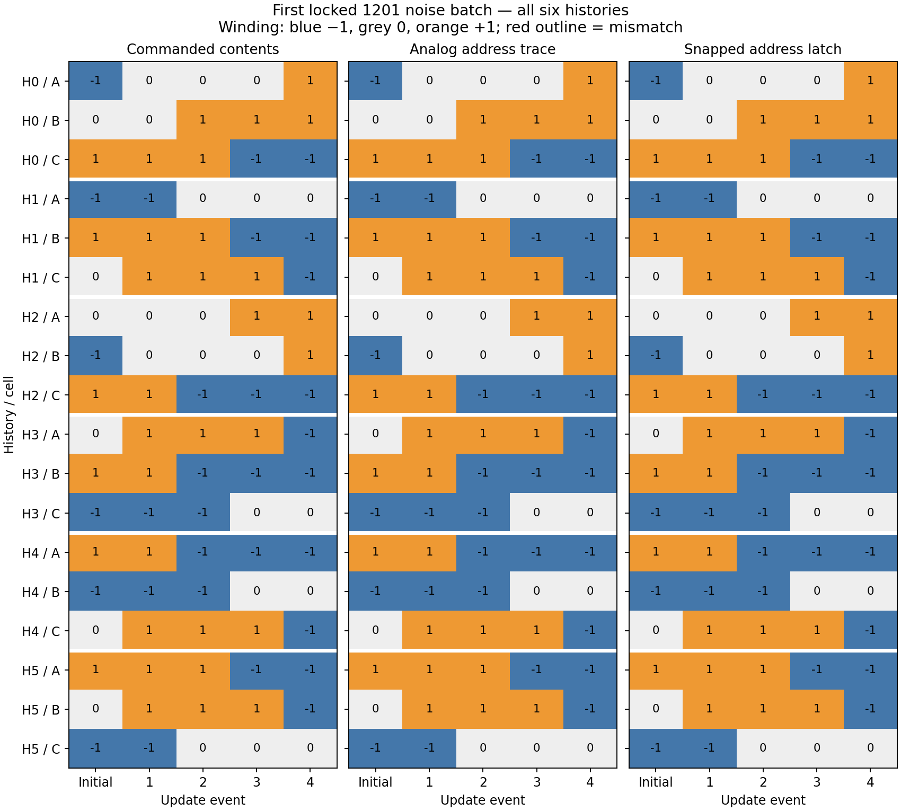

# Selective updates in a three-cell memory array

Mode: **development**. Locked source: `23b43c4383e1630e75f21b3218dc8679c6cc4a0e`.
1 independent noise-seed batches, 6 three-cell histories, 24 requested updates, 48 bystander exposures per arm.

| Ring controller | Correct address | Written before read | Bystanders survive | Whole array correct | Voted read of intended contents | Operational gate |
| --- | ---: | ---: | ---: | ---: | ---: | --- |
| trace | 100.00% | 100.00% | 100.00% | 100.00% | 100.00% | PASS |
| snap | 100.00% | 100.00% | 100.00% | 100.00% | 100.00% | PASS |
| oracle | 100.00% | 100.00% | 100.00% | 100.00% | 100.00% | PASS |
| shuffled | 0.00% | 12.50% | 50.00% | 0.00% | 23.61% | FAIL |
| all_open | 0.00% | 100.00% | 0.00% | 0.00% | 54.17% | FAIL |
| closed | 0.00% | 0.00% | 100.00% | 0.00% | 26.39% | FAIL |

**Analog-state benefit gate: FAIL.** Whole-array difference trace minus snapped latch = 0.00 percentage points; positive seed fraction 0.0%.

The snapped latch retains only a three-state address through the delay, encodable in two bits; actual storage uses an integer. Both controllers share a three-float cue accumulator and a trigger marker. The analog controller keeps integrating background activity during the delay. These policies are engineered. Neither learns an address mapping or the command value.

| Ordinary three-well array | Written before read | Bystanders survive | Whole array correct | Voted read |
| --- | ---: | ---: | ---: | ---: |
| trace | 100.00% | 100.00% | 100.00% | 100.00% |
| snap | 100.00% | 100.00% | 100.00% | 100.00% |
| oracle | 100.00% | 100.00% | 100.00% | 100.00% |
| shuffled | 12.50% | 68.75% | 0.00% | 25.00% |
| all_open | 100.00% | 25.00% | 0.00% | 54.17% |
| closed | 0.00% | 100.00% | 0.00% | 25.00% |

Independent cells share a broadcast write bias; there is no physical inter-cell coupling. Ordinary and ring media have unmatched energy, dimensionality and microscopic noise. No topology, efficiency or general learning advantage follows.

All event endpoints stay in the denominator, including consequences of earlier failed writes. Bystander survival rejects any stepwise departure or invalidity, even if the integer later returns. Readout uses five noisy local queries and a strict symbol majority; abstentions count wrong. Controllers see no field, reader output or scoring oracle.

Numerical check: {"logical_equal": true, "max_current_error": 0.002267216086866919, "max_field_error": 0.0010580938771797132, "pass": true}. One canonical history covers the entire repeated sequence and all arms; this is a sampled check.

The externally generated request supplies content. Spatial cue ports supply the address convention; learning where an object belongs remains untested. The result concerns access and reuse of a finite memory component.

